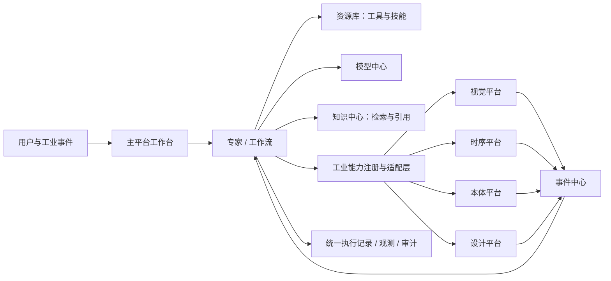

# 万悟工业智能体平台大改版：产品架构与落地规划

> 分析日期：2026-10-14。依据：用户本次需求、[9 张平台现状截图及后续 3 张补充截图](reference/current-platform-2026-10-14/README.md)、仓库内两份 2026-07-28 侧边栏方案和现有前端原型。本文是产品与架构建议，不把截图可见的界面误认为已验证的后端实现。

> 首页内容和工业平台卡片跳转已在 2026-10-29 调整；当前实现以[新版首页排版规划](首页排版规划-2026-10-29.md)为准，下文保留早期讨论脉络。

## 1. 结论与定位

建议把主平台定义为**专家与工作流的构建、运行和治理平台**，而不是把所有工业系统页面搬进同一个侧边栏。

- **专家**是面向人的持续性工作主体，基于你们改造的 Hermes；拥有职责、权限、工具、知识、记忆、任务和运行记录。它可以调用工作流，也可以处理需要判断、解释、追问的任务。
- **工作流**是可版本化的显式流程，负责确定的步骤、状态、审批、重试、补偿和交付结果；可调用专家，但不能只作为“另一种智能体卡片”。
- **模型中心**独立管理模型供给、接入、授权与配额；**资源库**管理专家和工作流可复用的工具/连接器、技能及模板；知识内容由知识中心管理。资源库也不是资产广场的同义词。
- **知识中心**基于改造的 WeKnora，负责知识资产生命周期与检索服务；专家/工作流只引用知识中心发布的检索能力，不各自维护一套文档库。
- **工业引擎**按“独立平台 + 平台级集成”处理。首页展示能力与开通状态；开通后才在相应业务位置出现入口、资源、事件与数据视图。事件引擎对应现有事件中心，不再复制一套事件菜单。

主平台应成为统一身份、组织、授权、资产引用、任务编排、追踪和审计的控制面。各工业平台保留自己的专业工作台、数据处理与运行服务，通过集成契约接入主平台。这样用户可以从一个业务任务进入专业能力，同时避免把复杂引擎的全部操作硬塞进主平台。

## 2. 截图揭示的现状与核心问题

1. [首页](reference/current-platform-2026-10-14/01-unibot-home.png)目前突出通用对话和模型选择，用户首次进入看不到“专家能做什么、工作流能自动处理什么、有哪些工业能力已开通”。建议首页从空白聊天页改为**工作总览**；目标导航移除 UniBot。
2. [广场](reference/current-platform-2026-10-14/02-asset-market.png)将智能体、工作流、对话流、方案等并列展示，[开发页](reference/current-platform-2026-10-14/03-agent-development.png)还把单智能体、多智能体、工作流、对话流当作同层类型。新定位下会干扰用户判断。建议外部只突出“专家、工作流、解决方案”，历史类型进入兼容视图。
3. [资源库](reference/current-platform-2026-10-14/04-resource-library.png)把模型、技能、插件、MCP、知识、记忆、提示词、安全护栏并排作为资源类型，混合了**可调用外部能力、运行配置、知识内容、开发模板和治理策略**。需要按生命周期、负责人及引用方式重新分层。
4. [事件接入](reference/current-platform-2026-10-14/05-event-ingress.png)与[事件任务](reference/current-platform-2026-10-14/06-event-tasks.png)已构成触发源 → 规则 → 执行链路，是后续工业事件与专家/工作流联动的基础，不应再建重复的“事件引擎后台”。
5. [镜像仓库](reference/current-platform-2026-10-14/07-image-registry.png)和[运行时](reference/current-platform-2026-10-14/12-high-code-agent-runtime.png)共同服务**托管高代码智能体**：部署、容器运行、扩缩容、镜像版本和访问入口。它们不是专家/工作流的通用运行后台；仅使用专家/工作流的普通用户不需要先理解 Pod、镜像和 YAML。
6. [工业引擎菜单](reference/current-platform-2026-10-14/09-industrial-engines-nav.png)显示了六个入口；本次需求明确其中事件引擎就是现有事件中心，其他多个“引擎”本质是独立平台。菜单现状不等于已有统一身份、授权或数据模型。

当前仓库 `app/page.tsx` 是侧边栏交互原型，部分页面为模拟内容；两份旧方案主要解决菜单层级、评测/观测归属和角色权限。它们关于“权限与数据范围分离”“最多两级导航”“事件中心保留”的原则可继承；“单/多智能体并列开发”和“工业引擎直接扩成二级菜单”需要按本次产品方向重写。

## 3. 推荐的产品对象与边界

### 3.1 用户看到的七类对象

| 对象 | 用户心智 | 核心生命周期 | 典型入口 |
|---|---|---|---|
| 专家 | 谁来负责、判断和协作 | 创建 → 配置 → 试运行 → 评测 → 发布 → 观测 → 迭代 | 专家中心 |
| 工作流 | 事情按什么步骤完成 | 设计 → 调试 → 评测 → 发布 → 触发/运行 → 复盘 | 工作流中心 |
| 托管高代码智能体 | 自定义代码开发的智能体在哪里部署和运行 | 导入/部署 → 验证 → 扩缩容 → 监控 → 更新/停用 | 智能应用下的高代码智能体托管 |
| 模型 | 用哪类模型完成推理、向量化或识别 | 接入 → 验证 → 授权 → 使用 → 监控 → 退役 | 独立模型中心 |
| 资源 | 能调用什么 | 接入 → 鉴权 → 验证 → 发布 → 授权 → 使用 → 下线 | 资源库 |
| 知识 | 根据什么事实回答/判断 | 接入 → 解析 → 审核 → 索引 → 发布 → 检索 → 更新 | 知识中心 |
| 工业能力 | 能处理哪类工业数据与业务 | 了解 → 申请 → 开通 → 配置 → 使用 → 停用 | 主平台首页大卡片及专业平台侧栏 |

**解决方案**是专家、工作流、模型、知识、工业能力配置的组合交付物；**资产广场**负责发现和复用已发布的组合及组件。广场里可以展示专家/工作流模板，但“我已创建的资源”和“全平台可发现的资产”必须有清晰归属与发布关系。

### 3.2 专家与工作流的协作边界

- 专家适合模糊输入、多轮沟通、跨资料推理、调用工具后解释结果；必须有明确职责边界、工具许可、知识范围、记忆策略和人工接管机制。
- 工作流适合稳定流程和可审计的步骤：分支、并行、定时、事件触发、人工审批、超时、重试、幂等、补偿和版本锁定。
- 专家可以发起工作流；工作流也可调用**特定版本**的专家。双向调用要有最大递归深度、预算、超时与循环检测。
- 统一定义 `Execution`、`Task`、`Trace`：用户或事件一次请求生成执行记录；其下有专家步骤/工作流节点/工具调用；所有调用带组织、操作者、来源、版本和关联 ID。这样才能跨中心追踪一次工业事件的处理全过程。

### 3.3 旧类型退场策略

不要直接删除数据库对象或关闭现有运行接口。建议实行四态：**仍可运行 → 停止新建 → 仅兼容维护 → 按使用情况迁移/归档**。

- 对话流：停止作为新建主选项；能等价表达的迁至工作流“对话节点/交互步骤”。带复杂上下文、渠道行为或特殊节点的对象先保留兼容运行，不承诺一键转换。
- 单智能体：经能力盘点后可包装为专家草稿；人设、工具、知识、权限和发布渠道需人工核对。简单问答资产也可作为专家模板，而非强制都转成长期运行的专家。
- 多智能体：不要简单重命名为“多个专家”。先判断其编排语义；确定性协作转工作流，动态分工可作为专家内部能力或未来协作能力。原任务、版本和审计记录保留。
- 旧广场卡片继续可打开、可运行；默认筛选与导航先隐藏旧类型，给存量作者明确的迁移入口与截止规则。统计旧类型的创建量、活跃使用、引用数量后，再决定删除时间。

## 4. 新的信息架构与首页

以下是方向性草图；具体一级/二级菜单、各入口内容与旧菜单迁移，以后续整理的[侧边导航栏规划与功能说明](侧边导航栏规划与功能说明.md)为准。

建议主导航采用始终可见的节标题和菜单项；首页工业平台卡片按开通状态进入介绍页或切换到专业平台侧栏：

```text
首页
资产广场
智能应用：专家｜工作流｜高代码智能体托管（按角色显示）
能力中心：模型中心｜知识中心｜资源库
事件中心
评测与观测
底部固定：用量统计｜API Key 管理｜平台运营｜管理中心
```

导航名称仍可由用户访谈调整。关键是让专家/工作流成为主线，资产广场紧随首页，模型中心与资源库平级。高代码智能体托管作为智能应用下的专业能力，页面内保留运行实例和镜像仓库；评测与观测独立承载专家/工作流质量闭环。工业平台入口位于首页大卡片：未开通进入介绍页，已开通切换到该平台的专属侧栏；“事件引擎”的操作由独立的事件中心菜单承载。

首页建议采用三段：

1. **主平台价值与任务入口**：一句话说明“用专家和工作流处理工业任务”，提供“创建专家 / 创建工作流 / 查看任务”直接动作。新用户看示例，老用户看最近工作。
2. **业务总览**：我的待办、运行中的任务、失败/待人工处理、已发布专家/工作流、知识更新和近期工业事件。按角色显示范围，不用同一个全平台指标混给普通用户。
3. **工业平台目录**：本体、视觉、时序、设计四张大卡片。每张展示解决场景、代表输入/输出、接入条件、状态（未开通/待审批/配置中/已开通/停用）和“查看介绍/申请开通/进入平台”。已开通用户应看到当前状态和业务动作；点击后使用专属侧栏。事件能力由独立事件中心入口承担。

每个能力详情页至少讲清：处理的问题、核心对象、典型流程、与专家/工作流/知识中心/事件中心的连接点、需要的数据、权限与部署条件、开通步骤、费用或资源占用（如适用）、使用示例。未开通时展示介绍页；已开通且有权限时进入专业平台侧栏。首页的具体排版另见[首页排版规划](首页排版规划.md)。

## 5. 资源库重新划界

### 5.1 推荐分类

| 分类 | 包含内容 | 是否作为专家/工作流引用对象 | 归属 |
|---|---|---|---|
| 工具与连接器 | HTTP/API、插件、MCP 服务及其工具、数据库、MES/ERP/IoT 连接器、工业能力适配器 | 是；统一为可调用能力目录，保留原协议类型 | 资源库 |
| 模型服务 | LLM、嵌入、重排、多模态/视觉模型及配额 | 是；按用途和能力声明选择 | 独立模型中心 |
| 技能与模板 | 可复用的操作步骤、专家模板、工作流模板、提示词模板 | 是；模板实例化后成为具体版本 | 资源库/广场 |
| 知识库 | 文档、FAQ、结构化知识、检索端点 | 是，但引用登记在资源库，内容治理在知识中心 | 知识中心 |
| 记忆 | 专家的工作记忆与长期记忆策略/数据 | 可配置，不应与共享工具并列出售或发布 | 专家设置/治理 |
| 安全护栏 | 敏感操作、输出、数据范围和人工审批策略 | 作为统一治理策略应用于引用 | 管理/治理中心 |

一个工具资产应有清楚的契约：名称、协议类型、提供方、版本、输入/输出 schema、环境、密钥引用、组织可见范围、数据分级、超时/重试、幂等性、可写/只读、审批要求、调用限额、健康状态、审计规则。**凭证存密钥管理系统，只在工具记录中保存引用**。专家与工作流使用同一资产 ID 与版本；禁止一个团队在两个入口重复维护同一连接器。

### 5.2 广场与资源库关系

资源库是“我/本组织能配置、授权并引用什么”；广场是“哪些已审核发布的能力可被发现、安装或复制”。发布动作从资源库/专家/工作流产生**快照版本**，广场展示该版本；安装到组织后形成可管理的引用或副本。需要标明所有者、来源、许可证/共享范围、版本、依赖与更新方式。

## 6. 基于 WeKnora 的知识中心

WeKnora 官方项目将知识库、检索问答和 Wiki 建在同一知识底座上，并提供可配置的解析、索引、检索及多工作空间能力；其当前开源实现可作为参考，而你们改造版的实际 API 和数据模型需要单独盘点。[官方项目](https://github.com/Tencent/WeKnora)、[架构文档](https://github.com/Tencent/WeKnora/blob/main/website-docs/02-architecture/01-overview.md)。

建议把知识中心设计为**全平台知识服务**，而不是仅嵌入 WeKnora 的原始 UI：

```text
数据源/文件 → 解析与质量检查 → 切分/结构化 → 索引与版本 → 发布检索端点
                                                   ↓
                         专家 / 工作流 / 工业平台按权限调用
```

最小能力：知识库及目录、文件与外部数据源同步、解析状态、失败重试、版本/更新时间、访问控制、检索调试、引用出处、反馈纠错、变更审计。工业场景应增加设备/产线/工厂/工艺等元数据和有效时间，支持“在某组织、工厂、设备、时间范围内检索”，避免查到别的设备或旧版本规程。

集成边界：身份与组织由主平台统一；知识中心维护内容和检索索引；主平台提供知识库目录和授权映射；专家/工作流绑定的是知识库 ID、检索策略与已批准的数据范围。检索时**服务端再次校验**组织、对象及文档权限，并返回引用出处、文档版本、片段位置。对工业知识可以考虑人工发布/回滚流程，尤其是操作规程与安全相关内容。

不要同时保留资源库“知识”和知识中心“知识库”两套上传/授权后台。原资源库中的知识配置迁为**知识中心资产引用**，历史知识库、文档、索引及原调用关系先建映射表，再逐批切流。

## 7. 工业平台：开通与融合模型

### 7.1 六个现有入口的目标归属

| 截图入口 | 建议定位 | 主平台融合点 |
|---|---|---|
| 本体引擎 | 独立本体平台/工业对象语义服务 | 设备、工厂、产线等统一对象引用；专家和工作流查询关系与规则 |
| 视觉感知引擎 | 独立视觉平台 | 检测任务/告警进入事件中心；结果和证据供专家解释、工作流处置 |
| 时序引擎 | 独立时序平台 | 指标与时间窗查询、异常事件、趋势数据供专家和工作流消费 |
| 设计引擎 | 独立设计平台 | 设计对象/版本/审查任务及结果作为工具和业务对象接入；具体边界待核实 |
| 事件引擎 | 现有事件中心的能力表述 | 对外介绍事件驱动能力；操作仍落在事件接入、任务和执行记录 |
| 工具插件 | 平台级资源能力 | 并入资源库“工具与连接器”，不作为一个工业平台售卖/开通 |

上表是基于名称和本次描述作的**目标建议**，不是对现有各平台功能的事实确认；尤其设计引擎的业务对象、数据范围与开通依赖需产品负责人核定。

### 7.2 “开通”必须有四层状态

1. **授权（Entitlement）**：哪个租户/组织、哪个能力、期限、配额、版本/套餐，谁批准，审计记录是什么。
2. **就绪（Provisioning）**：账号映射、网络、连接器、数据映射、初始同步、健康检查是否完成。
3. **权限（RBAC/ABAC）**：同一个已开通组织内谁可看、谁可配置、谁能执行写操作；设备/工厂等对象级权限如何继承。
4. **可见性（Feature exposure）**：菜单、工具、数据卡片是否显示。可见性从前三层推导，不能仅凭前端开关认定可调用。

状态可用 `未开通 → 待审批 → 开通配置中 → 已开通 → 暂停/到期 → 停用`。如果“已授权但未就绪”，详情页应显示配置进度和故障信息，不能让用户点击一个不可用的专业页面。停用时需要明确数据保留、历史任务可读范围、引用到该能力的专家/工作流如何降级。

### 7.3 何谓真正融合

开通后的最低标准不是单点登录跳转，而是以下能力至少形成闭环：

- **统一上下文**：组织、用户、工厂/产线/设备/设计对象、时间范围通过可信的 ID 映射传递；不靠名称匹配。
- **统一调用**：工业平台发布有版本的查询/动作 API 或事件契约，在资源库中登记为工具，专家与工作流可按权限调用。
- **统一事件**：视觉告警、时序异常、本体规则命中、设计审查结果可进入事件中心，触发工作流或专家任务，并回写处置状态。
- **统一追踪**：主平台任务 ID 与工业平台任务/告警 ID 可双向定位；跨系统 Trace、审计和错误码可关联。
- **统一数据呈现**：主平台展示摘要、状态、证据与下一步动作；复杂配置和专业分析保留在原平台工作台，携带上下文跳转。

建议有一层**工业能力注册与适配层**：能力清单（capability manifest）、租户开通记录、用户/组织/工业对象映射、工具/API 适配、事件映射、深链路、健康状态。每个平台按统一契约接入，而不是每加一个引擎就改主平台核心逻辑。



### 7.4 分场景落地示例

**视觉质检闭环**：视觉平台产生缺陷告警 → 事件中心标准化事件（设备/批次/图片证据/置信度）→ 工作流创建待处理任务 → 质量专家查询知识中心中的工艺标准、调用时序工具看同批次参数 → 人工确认 → 工作流把处置结论回写视觉平台/MES，并保留跨系统追踪。视觉平台未开通时，相关工具和事件订阅不可创建，首页仅展示介绍和申请入口。

**设备故障闭环**：时序平台发现振动异常 → 本体平台定位设备及上下游关系 → 专家基于检修规程提出诊断与证据 → 工作流派单、审批并跟踪维修。这个场景要求时序数据、知识文档与本体对象使用可关联的资产 ID 和时间语义。

## 8. 平台级技术与治理约束

- **身份/多租户**：主平台统一 SSO、组织、角色、服务账号。工业平台保留内部权限时，用显式映射和短期令牌；不可依赖共享管理员账号。
- **数据边界**：区分原始工业数据、衍生特征、告警、知识文档和专家记忆；为每次调用记录数据来源、用途和保留策略。大体量视频/时序原始数据留在专业平台，主平台存索引、摘要与引用。
- **工具安全**：只读与写操作分级；写 MES/设备/设计系统需更强的授权、参数校验和必要时人工审批。凭证独立托管，调用均可审计。
- **可靠性**：事件有统一 schema、去重键、重试/死信；工作流节点有超时、补偿和幂等设计；跨平台故障可降级并显示原因。
- **版本与依赖**：专家、工作流、工具、知识库、工业能力均有版本/兼容关系。已发布工作流引用固定版本或明确的升级策略，防止工具变更造成运行结果漂移。
- **质量闭环**：离线评测覆盖专家回答与工作流结果；线上观测覆盖模型/工具/知识检索/工业 API 调用，问题样本回流评测。旧方案的“评测与观测”思路可以复用，但对象名应扩展到专家与工作流。

## 9. 实施顺序与验收条件

### 阶段 A：盘点与决策（先于界面重画）

- 盘点旧类型数量、活跃度、引用关系和兼容约束；确认 Hermes 改造版与 WeKnora 改造版的实际 API、部署、账号、数据模型。
- 为本体/视觉/时序/设计平台各指定产品与技术负责人，填写“能力、对象、API、事件、权限、租户、部署、费用、数据归属”清单。
- 决定广场、资源库、知识中心间的归属与发布/安装机制；确定首个工业闭环场景。

验收：每类对象有唯一归属和 ID；首个场景可画出从触发到回写的时序；旧对象迁移清单可追踪。

### 阶段 B：建立主线与兼容入口

- 首页、专家中心、工作流中心、资源库新分类与知识中心入口先落地；新建流程默认只展示专家和工作流。
- 存量单/多智能体、对话流可继续查看和运行；新增兼容标签及迁移向导草稿，不改变历史 ID、执行记录和分享链接。
- 打通统一资产引用与版本、统一执行/Trace ID、组织与数据权限。

验收：用户能从首页创建专家/工作流，引用资源和知识，发布后获得可追踪运行记录；旧项目不中断。

### 阶段 C：首个工业能力闭环

- 优先选**视觉质检**或**时序异常**之一，不同时做四个平台。实现能力详情/申请/开通/就绪、工具适配、事件接入、跨系统任务与回写。
- 用真实组织权限、真实数据对象及失败/撤销场景验证流程。

验收：未开通组织不能通过菜单或 API 使用能力；已开通组织可以从告警/数据到专家分析、工作流处置、回写与审计形成闭环。

### 阶段 D：扩展和退场

- 把本体与其他平台接入同一契约；按使用数据决定旧类型的编辑/新建截止日期。
- 完善计量计费、配额、评测、观测、工业能力运营看板和平台治理。

验收：新增工业平台主要通过能力清单与适配器接入；不再新增一套独立身份、权限、事件或资源目录。

## 10. 当前需要产品负责人明确的决定

1. “专家”是否就是面向用户的正式名称？其与旧方案“数字员工”、现有专家 Beta、广场里的智能体模板如何区分？
2. 工作流会使用现有工作流引擎演进，还是要另建编排内核？对话流哪些节点必须保留？
3. 你们的 Hermes/WeKnora 改造版已有哪些能力、API 与租户模型？本文仅依据上游公开资料建立参考边界。
4. 设计引擎的具体业务对象、输入输出、权威数据源及可回写动作是什么？
5. 工业平台是按租户、组织、项目还是工厂开通？审批人、期限、费用、停用后的历史数据规则是什么？
6. 第一阶段选哪个可衡量的工业闭环场景？建议以真实客户任务而非菜单页面数量衡量改版成功。

## 参考

- 本仓库：[截图基线](reference/current-platform-2026-10-14/README.md)、[侧边栏信息架构设计方案](智能体平台侧边栏信息架构设计方案.md)、[方案二](智能体平台侧边栏信息架构设计方案二.md)、`app/page.tsx`。
- [WeKnora 官方仓库](https://github.com/Tencent/WeKnora)、[官方架构概览](https://github.com/Tencent/WeKnora/blob/main/website-docs/02-architecture/01-overview.md)。
- [Hermes Agent 官方仓库](https://github.com/NousResearch/hermes-agent)、[官方文档](https://hermes-agent.nousresearch.com/docs)。仅用于理解上游可参考的技能、工具和记忆能力；本文没有验证你们的改造分支。
